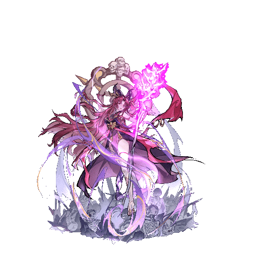
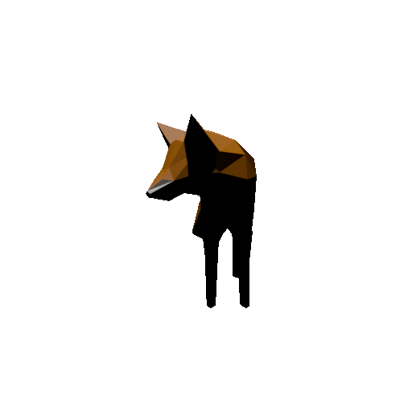

# desktop-pet

<p align="center">
  <strong>开源透明桌宠 · Open-source Transparent Desktop Pet</strong><br/>
  WebM 视频 · Spine 2D 骨骼 · glTF/GLB 真 3D<br/>
  可拖拽 · 可多开 · 坐姿守护 · 屏幕感知 · 可选 AI
</p>

<p align="center">
  <a href="LICENSE"></a>
  <a href="https://nodejs.org/"></a>
  <a href="https://github.com/Laurtiv27/desktop-pet"></a>
  <a href="https://github.com/Laurtiv27/desktop-pet/stargazers"></a>
</p>

<table align="center">
  <tr>
    <td align="center" width="33%">
      <br/>
      <sub><b>WebM</b> · 透明视频序列</sub>
    </td>
    <td align="center" width="33%">
      <br/>
      <sub><b>Spine</b> · 2D 骨骼</sub>
    </td>
    <td align="center" width="33%">
      <br/>
      <sub><b>GLB</b> · 真 3D（小狐狸）</sub>
    </td>
  </tr>
</table>

---

## Features

- **透明桌宠** — 上百个 VP9-alpha WebM；拖拽、物理、气泡与托盘常驻
- **Spine 2D 骨骼** — Spine 3.8 / 4.x 运行时分流；与视频宠同屏可配
- **glTF / GLB 真 3D** — Three.js + AnimationMixer；固定机位；原地表演与窗口位移分离
- **多开与设置** — 多只宠物同屏；设置页调大小、位置、人设与表现类型
- **坐姿守护** — 摄像头 + MediaPipe；趴桌 / 低头 / 疲劳提醒
- **屏幕感知** — 碎碎念可带一帧桌面截图（默认关；不落盘；可黑名单）
- **独立 AI** — 自备 API Key，支持碎碎念与对话（可选）

## Requirements

- Node.js `>= 22.12.0`
- 桌面环境（Electron）
- 坐姿守护需要摄像头权限
- AI 功能需自行配置兼容的模型服务

## Quick Start

```bash
git clone https://github.com/Laurtiv27/desktop-pet.git
cd desktop-pet
npm install
npm run build
npm run standalone
```

也可以：

```bash
npm run start:desktop   # 桌面入口
npm run start:app       # Electron 应用模式
npm run dist            # 打包分发
```

试用三维演示：把 [`assets/model3d/model3d-demo/pet-snippet.jsonc`](assets/model3d/model3d-demo/pet-snippet.jsonc) 追加到用户配置 `~/.dsh/dsh-pet/main-config.jsonc` 的 `pets`（勿覆盖默认女仆），然后重启 `standalone`。

试用 Spine 演示：见 [`docs/spine-free-motion.md`](docs/spine-free-motion.md)；焰灵等素材请遵守原站授权。

## Usage

### 坐姿守护

1. 启动桌宠后，打开**设置页**（托盘或右键 → 设置）
2. 在「坐姿守护」中勾选启用；灵敏度、冷却、蜂鸣 / 演出即时生效
3. 或在桌宠上**右键 → 坐姿守护**：启用 / 暂停 / 重新校准

趴桌、瘫坐会综合头下沉、脸凑近、低头等信号；另有持续下视提醒。首次启用时请允许摄像头权限。

配置目录：`$DSH_HOME/dsh-pet/`（默认 `~/.dsh`，可用环境变量 `DSH_HOME` 覆盖）

| 文件 | 说明 |
|------|------|
| `posture-config.json` | 开关、灵敏度、冷却、提醒方式 |
| `posture-api.json` | 本机控制口（运行时自动写入，勿手改） |

### 屏幕感知

1. 设置页打开「屏幕感知」并按需编辑黑名单
2. 需已配置 **支持看图** 的 AI；失败时回退为纯文本碎碎念
3. 窗口标题 / 进程名命中黑名单时跳过截屏（默认含密码管理、支付、银行等关键词）

截图只在内存中用于当次碎碎念，**不会写入磁盘**。

| 文件 | 说明 |
|------|------|
| `screen-context.json` | 开关与黑名单 |

### AI

在设置页填入协议、Base URL、模型与 API Key。未配置时桌宠仍可运行，仅碎碎念 / 对话不可用。

### 表现层一览

| `presentation` | 技术 | 文档 |
|---|---|---|
| `video`（默认） | 双缓冲 WebM | 内置配置即可 |
| `spine` | Spine WebGL 3.8 / 4.x | [docs/spine-free-motion.md](docs/spine-free-motion.md) |
| `model3d` | Three.js + glTF/GLB | [docs/model3d-presentation.md](docs/model3d-presentation.md) |

## Project Layout

```
src/standalone/     # 独立启动、设置页、AI
src/host/           # 桌宠宿主逻辑
src/shared/         # 坐姿 / 屏幕感知 / 行为编排
runtime/            # Electron helper（透明窗、托盘、Spine/Three）
assets/             # WebM、Spine、model3d、音效、坐姿模型
docs/               # Spine / model3d 设计与用法
```

## Acknowledgments

- 上游项目：[dsh-pet](https://github.com/PC2005-cloud/dsh-pet)
- 宠物动作素材：[AI 跟图 · 宠物动画](https://aigengtu.com/pet-anims)
- Spine 演示素材来源：[金猪资产库 · Spine](https://www.357p.com/spines/)（第三方站点；授权以原站为准）
- 三维演示小狐狸：Khronos glTF Sample Models · Fox（见 `assets/model3d/model3d-demo/NOTICE.txt`）

## License

代码 **MIT**，**遵循上游许可**。详见 [`LICENSE`](LICENSE) 与 [`NOTICE`](NOTICE)。

- 上游版权：PC2005-cloud  
- 本仓库改动：Laurtiv27  
- **素材禁止商用**（CC0 演示除外）；公开渠道二创须署名，并指向上游、本仓库与动作来源：  
  [dsh-pet](https://github.com/PC2005-cloud/dsh-pet) · [desktop-pet](https://github.com/Laurtiv27/desktop-pet) · [pet-anims](https://aigengtu.com/pet-anims)
