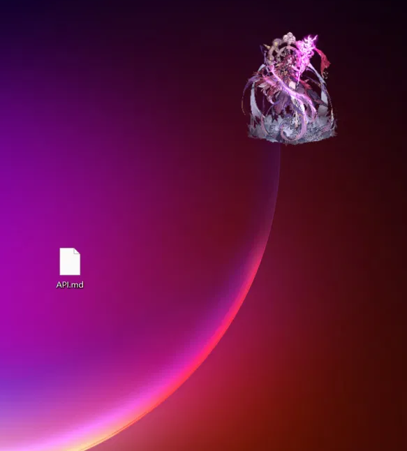

# Spine 素材目录约定

本地骨骼资源可放在本目录（设计目标路径）。**当前桌面播放端**演示资源在：

`runtime/electron-helper/spine-demo/`

## 演示角色（焰灵夜叉王）



- **Spine 动画来源：** [https://www.357p.com/spines/](https://www.357p.com/spines/)（金猪资产库 Spine 专区）
- 导出版本：**3.8.55**；需配置 `"runtime": "3.8"`
- 用途：本地验证双轨（视频女仆 + 骨骼宠）与循环待机；**请遵守原站授权，禁止擅自商用/二次分发**

## 换角色 / 自定义动画

1. 准备 Spine 导出（`.skel`/`.json` + `.atlas` + png）
2. 放入 `runtime/electron-helper/spine-demo/`（或后续接通的 `assets/spine/<root>/`）
3. 在 `~/.dsh/dsh-pet/main-config.jsonc` 配置：

```jsonc
{
  "presentation": "spine",
  "spine": {
    "root": "demo",
    "meta": {
      "runtime": "3.8",       // 3.8 导出必填；4.x 可省略
      "autoBehavior": false,  // false = 不乱跑，仅待机循环
      "skeleton": "skeleton.skel",
      "atlas": "skeleton.atlas",
      "clips": {
        "idle": "skin01_idle",
        "walk": "skin01_idle",
        "wave": "skin01_idle1"
      },
      "walkSpeedPx": 140,
      "defaultSkin": "default"
    }
  }
}
```

视频宠继续 `presentation: "video"`（或缺省），可与骨骼宠并存。

## 分发边界

未授权的 Spine 运行时、第三方示例与站点下载包**不要**默认打进正式发行物。自有授权导出可本地使用。
