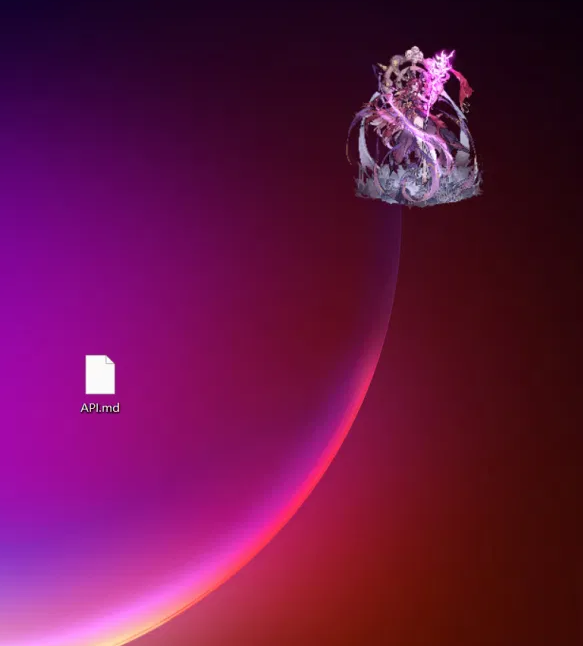

# Spine 骨骼双轨说明

状态：已合入 `main`（与 video / model3d 三轨共存）

视频宠（webm）与骨骼宠（Spine）可同时存在：`pets[].presentation` 为 `"video"`（缺省）或 `"spine"`。

## 演示截图



## Spine 动画来源

演示用立绘「焰灵夜叉王」来自：

**https://www.357p.com/spines/**

（金猪资产库 · Spine 专区。仅本地演示，请遵守原站授权，勿当作本仓库默认可商用/可再分发素材。）

本地文件：`runtime/electron-helper/spine-demo/skeleton.{skel,atlas,png}`  
运行时：Spine 3.8（`runtime/electron-helper/vendor/spine-webgl-3.8.js`）

## 试用

```bash
git checkout main
npm install
npm run build
npm run standalone
```

用户配置示例见 `assets/spine/README.md`。要点：

- `spine.meta.runtime: "3.8"`（本演示包必填）
- `spine.meta.autoBehavior: false` — 不自动乱跑；待机循环呼吸
- `spine.meta.clips` — 逻辑槽位 → 骨架内动画名

## 相关文件

| 路径 | 说明 |
|------|------|
| `assets/spine/README.md` | 自定义角色与配置约定 |
| `runtime/electron-helper/spine-demo/README.md` | 演示资源说明 |
| `runtime/electron-helper/sprite/presentation-spine-38.js` | 3.8 表现层 |
| `src/shared/behavior/spine-meta.ts` | meta 解析（runtime / skeleton / clips 等） |
