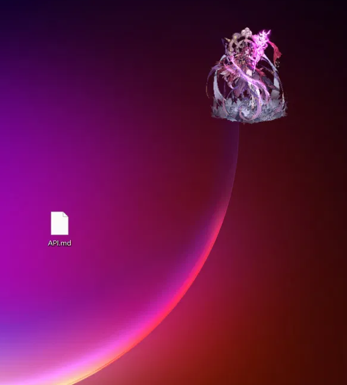

# 本地可见验证用 Spine 资源

## 当前演示：焰灵夜叉王（立绘）

| 项 | 说明 |
|----|------|
| 素材来源 | [金猪资产库 · Spine 专区](https://www.357p.com/spines/)（用户本机下载包「焰灵之骷髅」） |
| 格式 | Spine **3.8.55**（`skeleton.skel` + `skeleton.atlas` + `skeleton.png`） |
| 动画 | 主要为立绘待机：`skin01_idle` / `skin01_idle1` / `skin00_idle` / `skin00_idle1` |
| 播放 | 需 `pets[].spine.meta.runtime: "3.8"`，由 `presentation-spine-38.js` + `vendor/spine-webgl-3.8.js` 加载 |
| 授权 | **仅本地演示**；请遵守 [357p](https://www.357p.com/spines/) 原站授权，**不得**当作本仓库可再分发/商用美术 |

桌面实拍预览：

## 配置要点

在 `~/.dsh/dsh-pet/main-config.jsonc` 的骨骼宠上：

- `presentation: "spine"`
- `spine.meta.runtime: "3.8"`
- `spine.meta.skeleton` / `atlas`：文件名
- `spine.meta.clips`：逻辑槽位 → 真实动画名
- `spine.meta.autoBehavior: false`：不自动乱跑；待机仍循环呼吸

详细约定见 `assets/spine/README.md` 与设计规格 `docs/superpowers/specs/2026-11-16-spine-free-motion-design.md`。

## 备用：spineboy

仍保留 Esoteric 官方 4.2 示例 `spineboy-*`（仅开发验证）。改回时去掉 `runtime: "3.8"`，并改 `skeleton` / `atlas` / `clips`。正式发行勿打包未授权资源。
